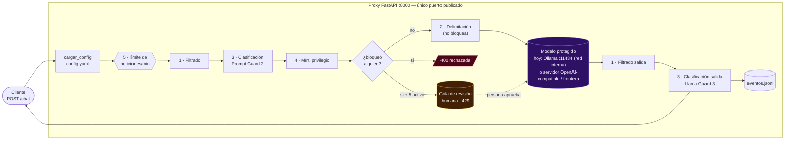
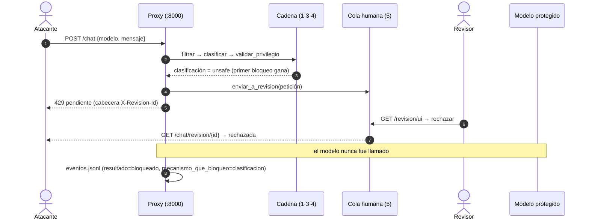

<div align="center">


# IronVeil

**Defensa en profundidad para proteger un LLM, local o de frontera, de la inyección de prompt y la extracción de datos.**
Pensado para los modelos autoalojados con Ollama que quedan expuestos por accidente en internet, y válido para cualquier otro modelo detrás del proxy.
Cinco mecanismos defensivos activables por bandera, siete configuraciones experimentales y una pregunta:
*¿qué combinación ofrece la mejor relación protección / utilidad / costo?*

[](https://github.com/Anderfg13/IronVeil/actions/workflows/ci.yml)
[](LICENSE)


[Arquitectura](#arquitectura) · [Inicio rápido](#inicio-rápido-un-solo-comando) · [Las 7 configuraciones](#las-7-configuraciones) · [Resultados](#dónde-están-los-resultados) · [Estructura](#estructura-del-repositorio) · [Reproducir](#reproducir-los-resultados)



*Una petición legítima (verde) atraviesa la cadena y vuelve revisada; un ataque (rojo) lo detiene la clasificación y la aprobación humana lo encola (429).*

</div>

---

## Qué es IronVeil

Un modelo de lenguaje expuesto sin protección permite a cualquiera extraer el *system prompt*, inyectar instrucciones, moverse entre modelos o agotar los recursos. El caso más común y el que motiva el proyecto es un servidor **Ollama autoalojado** publicado en internet por accidente, pero el problema es el mismo con cualquier modelo. IronVeil es un **proxy FastAPI** que se sienta entre el cliente y el modelo e implementa cinco defensas, **cada una apagada o encendida con una sola línea de `config.yaml`**:

| # | Mecanismo | Bandera | Naturaleza |
|---|-----------|---------|------------|
| 1 | **Filtrado** | `filtrado` | Determinista: patrones/regex sobre entrada y salida |
| 2 | **Delimitación** (spotlighting) | `delimitacion` | Determinista: reestructura el prompt con marcadores aleatorios; no bloquea |
| 3 | **Clasificación** | `clasificacion` | Probabilístico: por defecto Prompt Guard 2 (entrada) + Llama Guard 3 (salida), intercambiables por otro modelo local o de frontera; falla cerrada |
| 4 | **Mínimo privilegio** | `minimo_privilegio` | Determinista: rechaza una credencial de otro dominio |
| 5 | **Aprobación humana + rate limit** | `aprobacion_humana` | Humano en el bucle: encola (429) en vez de rechazar (400) |

El experimento mide cuánto reduce cada mecanismo —solo o combinado— la **Tasa de Éxito de Ataque (ASR)** frente a cinco vectores: **V1** reconocimiento · **V2** extracción de system prompt · **V3** inyección de prompt · **V4** movimiento lateral · **V5** agotamiento de recursos. Dos modelos (`soporte` y `rrhh`) guardan un secreto ficticio (canario) en su *system prompt*; si el canario aparece en la respuesta, el ataque tuvo éxito.

### Qué modelos puede proteger

Los cinco mecanismos no dependen del modelo: trabajan sobre el texto que entra y el que sale, así que el proxy sirve igual para:

- **Modelos locales con Ollama** (el caso del experimento: `soporte` y `rrhh`).
- **Cualquier servidor compatible con la API de OpenAI** (vLLM, LM Studio…) y **modelos de frontera** (OpenAI, Anthropic). Es una extensión opcional (`MODELOS_REMOTOS`): los terceros están apagados salvo permiso explícito, porque el texto sale de tu red. Guía: [`docs/MODELO_PROTEGIDO_REMOTO.md`](docs/MODELO_PROTEGIDO_REMOTO.md).

El **clasificador** también es intercambiable (Prompt Guard, Llama Guard, Jev, un modelo de frontera como juez…): [`docs/CAMBIAR_MODELO_CLASIFICADOR.md`](docs/CAMBIAR_MODELO_CLASIFICADOR.md). Lo que está **medido** en este repositorio es el caso de Ollama con `llama3.2:1b`; los demás modelos se admiten pero no se evaluaron con la misma batería (ver [`docs/GUIA_PARA_EL_PAPER.md`](docs/GUIA_PARA_EL_PAPER.md)).

> **Es un trabajo académico.** Todo el laboratorio corre en Docker, en tu propia máquina. Nunca apuntes estos ataques contra servidores de terceros. Las credenciales (`SPT-DEMO-*`, `RRHH-DEMO-*`) son **ficticias** y viven solo en `.env` / Modelfiles.

## Arquitectura

<details open>
<summary><b>Flujo de una petición</b> (Mermaid, se renderiza en GitHub)</summary>



**Reglas que gobiernan la cadena** (detalle en [`docs/arquitectura.md`](docs/arquitectura.md)):
- La cadena es una **lista de pasos recorrida en bucle**, no `if` anidados; el primer mecanismo que bloquea corta la cadena (`mecanismo_que_bloqueo` en el log).
- La **delimitación** no bloquea: se aplica aparte, justo antes de llamar a Ollama.
- La **aprobación humana** no es un paso más: *intercepta* el bloqueo y lo convierte en cola (429). Encolar es una demora, no una caída.
- La **clasificación** evalúa el texto original del usuario, no el ya envuelto por la delimitación.
- **Fail closed:** un timeout o error del clasificador cuenta como `unsafe`.
- El mismo código ejecuta las 7 configuraciones; solo cambia `config.yaml`.

</details>

<details>
<summary><b>Secuencia: petición bloqueada y encolada</b></summary>



</details>

### Diagrama de clases (animado)

<p align="center"></p>

El núcleo depende de **puertos** (`Protocol`) y los **adaptadores** (almacenes, formatos y destinos SIEM, decodificadores) se registran por configuración, sin editar el núcleo. Los paquetes `memoria_decisiones/` y `siem/` son la referencia del patrón (SOLID, ver [`CLAUDE.md`](CLAUDE.md) §7).

### Versión interactiva

Abre **[`docs/diagramas/index.html`](docs/diagramas/index.html)** (o, con GitHub Pages activado, <https://anderfg13.github.io/IronVeil/diagramas/>): eliges una configuración C0–C6, envías una petición legítima o un ataque (V2–V5) y ves qué pieza se ilumina, cuál bloquea y si termina en 400, en cola (429) o exitosa. Es una **simulación didáctica**; las cifras reales están en [`analisis/resultados_finales.md`](analisis/resultados_finales.md).

## Inicio rápido (un solo comando)

**Requisitos:** Docker con Compose v2 (`docker compose`), ~10 GB de disco libre e internet la primera vez (imagen de Ollama, modelo base y, para la clasificación de entrada, Prompt Guard).

```bash
git clone https://github.com/Anderfg13/IronVeil.git && cd IronVeil
cp .env.example .env          # variables y canarios ficticios (nunca se sube a git)
docker compose up --build     # levanta Ollama + inicializa modelos + proxy
```

La primera vez descarga el modelo base (`llama3.2`), el clasificador `llama-guard3:1b` y construye la imagen del proxy; puede tardar varios minutos. El proxy no arranca hasta que `ollama-init` termina con éxito. Cuando los logs digan que `ironveil-proxy` escucha en el puerto 8000, está listo:

```bash
curl -X POST http://localhost:8000/chat -H 'Content-Type: application/json' \
  -d '{"modelo":"soporte","mensaje":"hola, ¿en qué me puedes ayudar?"}'
```

> **Clasificación de entrada (C3 y C6):** usa *Llama Prompt Guard 2*, un modelo con licencia restringida en Hugging Face. Acepta la licencia, crea un token y ponlo en `HF_TOKEN` dentro de `.env`. Sin token, esa pieza **falla cerrada** (bloquea todo), por diseño. Las demás configuraciones no lo necesitan.

**Usuario de prueba (opcional).** El laboratorio arranca abierto, como lo necesitan los experimentos. Para probar la
autenticación del proxy hay un usuario `admin` con una clave **aleatoria** (no existe una clave por defecto publicada):

```bash
python -m proxy.auth --demo           # crea la cuenta; la clave queda en credenciales-demo.local.txt
# en .env: CHAT_REQUIERE_AUTENTICACION=1   y   IRONVEIL_DEMO=1
docker compose up -d proxy
curl -u admin:LA_CLAVE -X POST http://localhost:8000/chat -H 'Content-Type: application/json' \
  -d '{"modelo":"soporte","mensaje":"hola"}'      # sin -u responde 401
```

`/chat` y la consola `/revision/ui` usan las mismas cuentas; el chat de `/demo` pide login. Detalles en
[`docs/AUTENTICACION.md`](docs/AUTENTICACION.md).

**Comprobar el aislamiento** (debe fallar con *connection refused*; Ollama no se publica al host):

```bash
curl http://localhost:11434
```

**Apagar:** `docker compose down` · borrar también los modelos: `docker compose down -v`.

## Las 7 configuraciones

| Config. | Mecanismos activos | Para qué sirve |
|---------|--------------------|----------------|
| **C0** | ninguno | línea base (passthrough puro) |
| **C1** | filtrado | |
| **C2** | delimitación | |
| **C3** | clasificación | |
| **C4** | mínimo privilegio | |
| **C5** | aprobación humana + rate limit | |
| **C6** | los cinco | defensa en profundidad |

Cambiar de configuración es **editar `config.yaml`** (el proxy lo relee en cada petición; no hay que reconstruir nada). Un atajo que escribe las cinco banderas por ti:

```bash
python scripts/seleccionar_config.py C3     # escribe config.yaml con C3 (solo clasificación)
```

o a mano (`config.yaml`, las cinco claves son obligatorias; si falta una el proxy falla ruidosamente):

```yaml
filtrado: false
delimitacion: false
clasificacion: true      # ← C3
minimo_privilegio: false
aprobacion_humana: false
```

Luego lanza los ataques contra el proxy local, indicando la configuración que declaras (el script verifica que coincida con `config.yaml`):

```bash
pip install -r requirements-dev.txt                     # solo para los scripts del host
python -m ataques.vectores_1_2_3 --configuracion C3     # V1, V2 y V3
python -m ataques.vector4_movimiento_lateral --configuracion C3
python -m ataques.vector5_agotamiento --modelo soporte --configuracion C3
python -m ataques.vector6_adaptativo --configuracion C6 # adaptativo, contra la cadena completa
```

Los eventos quedan en `resultados/AAAA-MM-DD/eventos.jsonl` (esquema de 8 campos base, ver [`CLAUDE.md`](CLAUDE.md) §4). Para el recorrido completo C0→C6 en GPU: [`resultados/RECORRIDA_GPU_C0_C6.ipynb`](resultados/RECORRIDA_GPU_C0_C6.ipynb).

## Dónde están los resultados

| Qué | Dónde |
|-----|-------|
| **Respuesta a la pregunta de investigación** y tabla maestra | [`analisis/resultados_finales.md`](analisis/resultados_finales.md) |
| Tabla maestra (CSV / Markdown / LaTeX) | `analisis/tabla_maestra.{csv,md,tex}` |
| Hipótesis vs. ASR medido, celda por celda | [`analisis/matriz_real_vs_hipotesis.md`](analisis/matriz_real_vs_hipotesis.md) |
| Costo de latencia por mecanismo | [`analisis/costo_por_mecanismo.md`](analisis/costo_por_mecanismo.md) |
| Gráficas finales | [`resultados/graficas_finales/`](resultados/graficas_finales/) |
| **Datos crudos** (evidencia, no se editan a mano) | [`resultados/resultados_template.csv`](resultados/resultados_template.csv) y `resultados/AAAA-MM-DD/` |
| Filas descartadas con su razón | [`resultados/descartados.csv`](resultados/descartados.csv) · [`docs/LIMPIEZA_DATOS.md`](docs/LIMPIEZA_DATOS.md) |
| De dónde sale cada tabla y figura del informe | [`docs/DE_DONDE_SALE_CADA_TABLA.md`](docs/DE_DONDE_SALE_CADA_TABLA.md) |
| Decisiones de diseño y conflictos resueltos | [`docs/FUENTE_DE_VERDAD.md`](docs/FUENTE_DE_VERDAD.md) · [`docs/CONFLICTOS_RESUELTOS.md`](docs/CONFLICTOS_RESUELTOS.md) |

Lectura honesta de los resultados (sobre `llama3.2:1b`, corridas en GPU T4 de Colab): el ASR promedio V1–V4 baja de **31,2 % en C0 a 15,0 % en C1 y en C6**; la clasificación es la única pieza con costo apreciable (**≈ 75 ms** de sobrecosto propio, p95 ≈ 95 ms), y **ninguna combinación llega a 0 %**, como anticipa la literatura. Las diferencias de uno o dos eventos no se distinguen del ruido del LLM (el modelo no es determinista); cada comparación lleva su valor p. Las cifras, sus límites y lo que **no** se puede afirmar están en `analisis/resultados_finales.md`.

## Estructura del repositorio

```text
IronVeil/
├── config.yaml                 # las 5 banderas: lo único que cambia entre C0..C6
├── docker-compose.yml          # Ollama + ollama-init + proxy (solo :8000 se publica)
├── .env.example                # variables y canarios ficticios (copiar a .env)
├── proxy/                      # el framework
│   ├── main.py                 #   FastAPI: POST /chat y la cadena de mecanismos
│   ├── mecanismos.py           #   los 5 mecanismos (contrato estable, CLAUDE.md §4)
│   ├── cola.py                 #   cola de revisión humana + rate limit
│   ├── siem/                   #   extensión: export a Wazuh/Splunk/Elastic/… (puertos y adaptadores)
│   ├── memoria_decisiones/     #   extensión: recuerda los rechazos humanos
│   ├── normalizacion/          #   extensión: decodifica Base64/hex/ROT13 antes de la cadena
│   └── static/                 #   consola de revisión humana (/revision/ui) y logo
├── ollama/                     # init.sh y Modelfiles (plantillas, sin credenciales)
├── ataques/                    # vectores V1–V7, medición de costo, validación externa con Garak
├── analisis/                   # consolidación, estadística, tablas y gráficas
├── resultados/                 # datos crudos (CSV/JSONL), gráficas y notebooks de corrida
├── scripts/                    # utilidades (seleccionar_config.py)
├── tests/                      # pytest: sin Docker ni Ollama (clasificador con mocks)
├── docs/                       # arquitectura, decisiones, guías, diagramas
│   ├── assets/                 #   diagramas animados (SVG)
│   └── diagramas/              #   visor interactivo (HTML)
├── .github/                    # CI, publicación de release/paquete, plantilla de PR
├── CLAUDE.md                   # contrato y reglas del equipo
└── LICENSE
```

## Reproducir los resultados

```bash
python -m venv .venv && source .venv/bin/activate   # Windows: .venv\Scripts\activate
pip install -r requirements-dev.txt                 # versiones exactas
python -m pytest -q                                 # suite completa: no necesita Docker ni Ollama
ruff check . && black --check .                     # lint y formato

python analisis/validar_dataset.py                  # valida el CSV crudo
python analisis/consolidar.py                       # ASR por configuración y vector
python analisis/tabla_maestra.py                    # tabla maestra del informe
python analisis/graficas_finales.py                 # gráficas en resultados/graficas_finales/
```

Reglas del dato: los CSV y logs de `resultados/` son **evidencia**; toda transformación pasa por un script reproducible y ninguna fila se borra (se mueve a `descartados.csv` con su razón).

## Extensiones opcionales (apagadas por defecto)

| Extensión | Qué hace | Documentación |
|-----------|----------|---------------|
| Consola de revisión humana | UI en tiempo real (SSE) con login opcional: `/revision/ui` | [`docs/DEMO.md`](docs/DEMO.md) |
| Chat de demo | Pantalla `/demo` (`IRONVEIL_DEMO=1`) | [`docs/DEMO.md`](docs/DEMO.md) |
| SIEM | JSON/CEF/LEEF/ECS hacia archivo, syslog, HTTPS, Splunk, Elastic, Azure, CloudWatch | [`docs/SIEM.md`](docs/SIEM.md) |
| Memoria de decisiones | Rechaza solo lo que un humano ya rechazó | [`docs/MEMORIA_DE_DECISIONES.md`](docs/MEMORIA_DE_DECISIONES.md) |
| Normalización de entrada | Decodifica lo que el atacante escondió | [`docs/NORMALIZACION_DE_ENTRADA.md`](docs/NORMALIZACION_DE_ENTRADA.md) |
| Otro clasificador (p. ej. Jev) | Cambiar de modelo clasificador sin tocar `clasificar()` | [`docs/CAMBIAR_MODELO_CLASIFICADOR.md`](docs/CAMBIAR_MODELO_CLASIFICADOR.md) |
| Modelo protegido remoto | Proteger un modelo servido por otra API | [`docs/MODELO_PROTEGIDO_REMOTO.md`](docs/MODELO_PROTEGIDO_REMOTO.md) |
| Validación externa con Garak | Segunda instancia del proxy atacada por Garak | [`docs/GARAK.md`](docs/GARAK.md) |
| Excessive Agency (V7) | Herramientas **simuladas** de `rrhh-agente` | `ataques/variantes_ataque.md` |

## Seguridad y ética

- **Laboratorio aislado:** todo ataque, carga o escaneo va contra el stack propio en localhost/Docker, nunca contra terceros.
- **Ollama nunca se publica al host:** solo el proxy expone el puerto 8000.
- **Autenticación opcional:** `CHAT_REQUIERE_AUTENTICACION=1` exige usuario y clave en `/chat` (falla cerrada si no hay cuentas); la consola de revisión tiene login con sesión y CSRF. Apagada por defecto para no alterar lo medido.
- **Sin secretos en el código:** los canarios viven en `.env`/Modelfiles; las dependencias están fijadas con versión exacta (y con hashes en la imagen del proxy).
- **Mensajes de error genéricos** hacia el cliente; el detalle se registra solo en el servidor.
- Las herramientas de la extensión V7 están **simuladas** y marcadas como tales en el código.

## Instalar como paquete

```bash
pip install ironveil        # en un entorno virtual; necesita un Ollama alcanzable
ironveil config C3 && ironveil serve
```

Publicación en PyPI y límites: [`docs/PUBLICAR_PYPI.md`](docs/PUBLICAR_PYPI.md). El sitio con el visor interactivo y los
diagramas animados se publica con GitHub Pages: <https://anderfg13.github.io/IronVeil/>.

## Versiones y paquetes

La entrega final está marcada con la etiqueta [`entrega-final-2026-10-31`](https://github.com/Anderfg13/IronVeil/releases) (ver [`docs/RELEASE_NOTES.md`](docs/RELEASE_NOTES.md)). Al subir una etiqueta, GitHub Actions publica la *release* y la imagen del proxy en GitHub Packages:

```bash
docker pull ghcr.io/anderfg13/ironveil-proxy:entrega-final-2026-10-31
```

## Equipo y contribución

**Anderson Fabian Garcia Nieto** (infraestructura, filtrado, clasificación, mínimo privilegio, cola y costo) · **Carlos Mario Piedrahita Arango** (configuración, delimitación, integración, interfaz de aprobación y SIEM) · **Andres Felipe Sabogal Wilches** (ejecución de los vectores de ataque) · **Ana Gabriela Fiquitiva Poveda** (esquema de log, consolidación, gráficas e informe). Las reglas de trabajo, los contratos estables y la lista de comprobación de cada tarea están en [`CLAUDE.md`](CLAUDE.md); las PR usan la [plantilla](.github/PULL_REQUEST_TEMPLATE.md).

[Cómo contribuir](CONTRIBUTING.md) · [Seguridad](SECURITY.md) · [Código de conducta](CODE_OF_CONDUCT.md) · [Cómo citar](CITATION.cff)

Licencia [MIT](LICENSE) · uso exclusivamente académico y en laboratorio propio.
